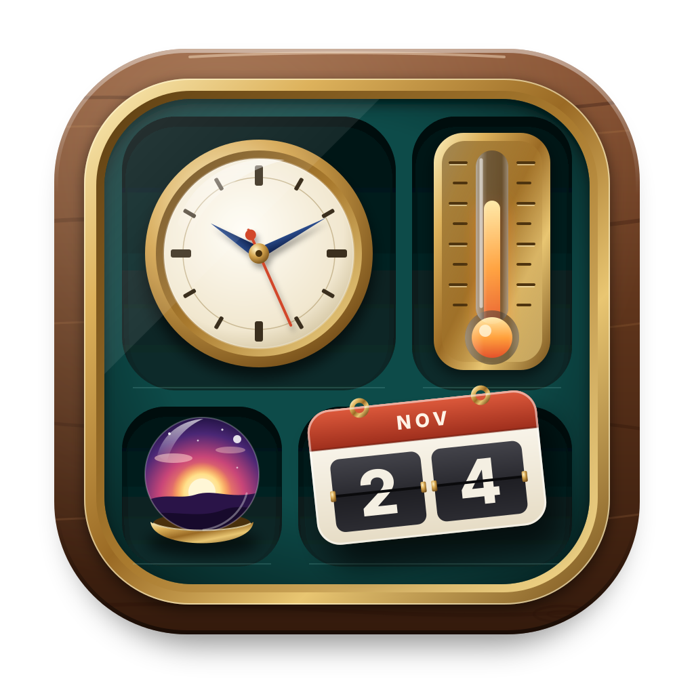

<p align="center">
  <picture>
    <source media="(prefers-color-scheme: dark)" srcset="crates/manager/assets/logo-dark.svg">
    
  </picture>
</p>

# Calmdesk

**Your desktop, beautifully alive. The widget center Windows 11 deserves.**

Calmdesk brings gorgeous, glanceable widgets to the Windows desktop: the time across the
world, your next meeting, the weather, your music, your battery, your notes. Everything you
need at a glance, right on the wallpaper, in materials that look like they were made by
Microsoft itself.

**[Download Calmdesk for free](https://github.com/rom5n/calmdesk/releases/latest)**: one small
installer, no admin rights, ready in seconds.


*Every built-in widget, in liquid glass with the light theme.*

## Why you will love Calmdesk

### Stunning by design

- **Liquid glass.** Widgets bend and refract your wallpaper through a real glass edge, with a
  delicate rainbow rim. Prefer something calmer? Frosted, solid or fully clear, one click away.
- **Feels native.** Light and dark mode, your accent color, your language and your monitor's
  sharpness are followed automatically. Calmdesk looks like part of Windows, not an add-on.
- **Fluid motion.** Smooth second hands, springy buttons and gentle fades on every widget.

### Make it yours

- **Every widget, your style.** Right-click any widget to change its size (Small to Huge),
  material, transparency, blur, tint, corners, shadow, theme, font and colors.
- **Smart defaults.** Style one clock the way you like, and the next clock you add starts
  looking just like it.
- **Place it anywhere.** Double-click and hold to move a widget; it snaps neatly to screen edges
  and to other widgets.

### All your widgets, in one place

- **A beautiful gallery.** Browse every widget by category, search by name, then drag one onto
  the desktop or simply click it.
- **Open to every app.** Widgets from other apps appear in the same gallery, with the same
  look and the same settings, so your desktop always feels like one design.
- **Always there.** Calmdesk starts with Windows and brings your widgets back exactly where you
  left them.

### Out of your way

- **No window to manage.** Calmdesk lives quietly in the notification area.
- **Respects your games and movies.** Widgets step aside while a fullscreen app runs on their
  monitor, and come back when you are done.
- **Your data stays yours.** Notes and tasks are plain text files on your PC. No account, no
  sign-in, no tracking.
- **Back up in one click.** Export your whole desktop setup and import it on any PC.
- **Always up to date.** Calmdesk lets you know when a new version is out.

## 40+ widgets included

| | |
|---|---|
| **Time** | Digital, bold and outline clocks, analog clocks in classic, modern and minimal styles, world clock, dual clock, calendar |
| **Focus** | Timer, stopwatch, pomodoro |
| **Productivity** | Notes and to-do lists, upcoming events from Google or Outlook calendars |
| **Weather** | Current conditions and forecast for your city or any city in the world, available offline with the last forecast |
| **Media** | Now Playing with artwork and controls for any music or video app |
| **System** | Battery, system monitor (processor, memory, graphics), screen time, Bluetooth headphones and controller battery |
| **Quick switches** | Wi-Fi, Bluetooth, energy saver, airplane mode |
| **Photos** | Your favorite photo, or a folder that shows a new photo every 15 minutes |
| **Finance** | Live exchange rates for USD, EUR, RUB, GBP, CNY, JPY, CHF, PLN and CAD |
| **Smart stack** | Clock, weather and system load in one widget, taking turns |

Available in 12 languages: English, Russian, Ukrainian, German, French, Spanish, Italian,
Portuguese, Polish, Chinese, Japanese and Korean. 14 hand-picked fonts are included.

## For widget authors

Make your widgets for Calmdesk, so users find them in the one gallery they already use,
with the same look and the same settings menu as every other widget.

1. Build the package with [widgine](https://github.com/rom5n/widgine): a folder
   with `widget.toml` and `layout.xml`. The engine's
   [guide](https://github.com/rom5n/widgine/blob/main/docs/guide.md) goes step by step.
2. Give it a unique reverse-domain `id` (`com.yourname.weather`), keep `engine = "^0.1"`, and
   allow the customizations that make sense (`size`, `background`, `theme`, ...), so it fits
   in with the built-in widgets.
3. Feed live values from your app with `widgine::host` (Rust) or `we_host_set` (C);
   Calmdesk shows the widget in its own process and passes clicks back to your app.
4. Install it to `%LOCALAPPDATA%\Widgets\<package>`, `%ProgramData%\Widgets\<package>`, or
   register its folder under `HKCU\Software\Widgine\Packages`. Calmdesk finds it the next
   time the gallery opens.

Details: [Getting into the Calmdesk gallery](https://github.com/rom5n/widgine/blob/main/docs/authoring.md#getting-into-the-calmdesk-gallery)
and [Publishing a package](https://github.com/rom5n/widgine/blob/main/docs/authoring.md#publishing-a-package).

## Settings and data

The tray menu's Settings: start with Windows, hide widgets during fullscreen apps, language,
export and import (through `Documents\Calmdesk backup`), the log folder
(`%LOCALAPPDATA%\calmdesk\calmdesk.log`) and the update check (GitHub releases, once a day).

Weather comes from Open-Meteo, the city from the PC's IP address (ipinfo.io) unless you pick
one. Exchange rates come from Exchange Rate API (open.er-api.com). The fonts in `fonts/` are
Google Fonts under the SIL Open Font License, with their licenses next to them.

## Building

Calmdesk depends on [widgine](https://crates.io/crates/widgine) (formerly widget-engine). The
`[patch.crates-io]` section in `Cargo.toml` builds it from a checkout next to this one, so
engine changes show up right away; remove that section to build against the published crate.

```
some-folder/
  engine/     https://github.com/rom5n/widgine
  calmdesk/   this repository
```

```bash
git clone https://github.com/rom5n/widgine.git engine
```

```bash
git clone https://github.com/rom5n/calmdesk.git calmdesk
```

```bash
cd calmdesk
```

```bash
cargo build --release -p calmdesk
```

```bash
cargo build --release -p calmdesk-setup
```

`target/release/calmdesk-setup.exe` is the installer: one exe with Calmdesk and the built-in
widgets inside. It installs for the current user (no admin rights) to
`%LOCALAPPDATA%\Programs\Calmdesk`, adds a Start menu shortcut and an Apps & features entry,
and turns on the start with Windows. Uninstall from Apps & features. Build `calmdesk` first:
the installer packs the `calmdesk.exe` it finds next to it. It replaces an install from when
the app was called Widget Center or Widget Manager, and moves the widgets over.

Signing: with a code-signing certificate in the user's store, set `CALMDESK_CERT` to its
thumbprint and run `tools\sign.ps1 target\release\calmdesk.exe` before building the
installer, then `tools\sign.ps1 target\release\calmdesk-setup.exe`.

## Layout of this repository

| Path | What |
|---|---|
| `crates/manager` | Calmdesk: tray, widget gallery, package scan, autostart, data feeds |
| `crates/installer` | `calmdesk-setup.exe`: the installer |
| `crates/media` | Now Playing feed (Windows media session API) for `widgets/media`, also a standalone app |
| `widgets/` | The built-in widget packages |
| `tools/` | `gen_widgets.py` writes most of `widgets/`; `tr.py` holds their translations |
| `fonts/` | Shipped fonts (SIL Open Font License) |
| `schemas/` | Copies of the engine's schemas, for editors |

## License

MIT, see [LICENSE](LICENSE).
