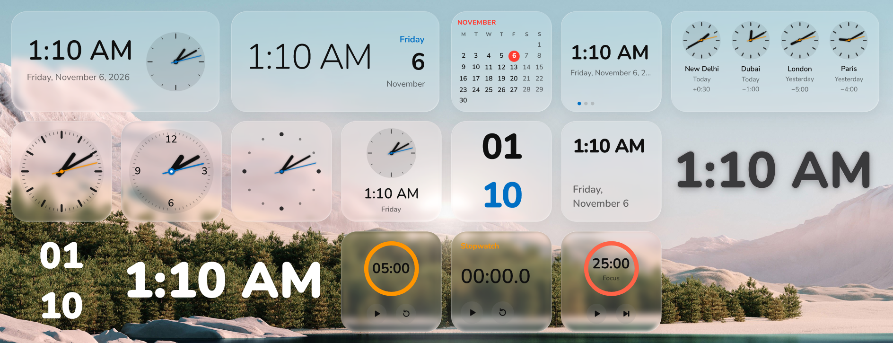
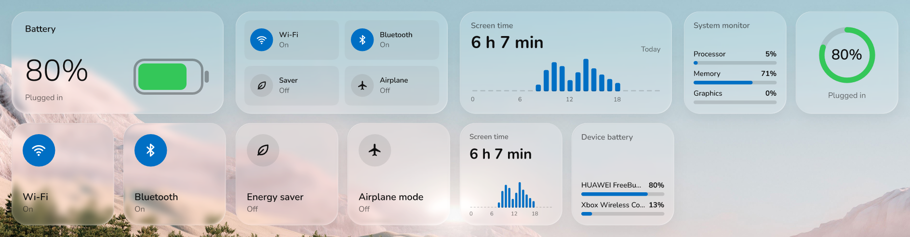
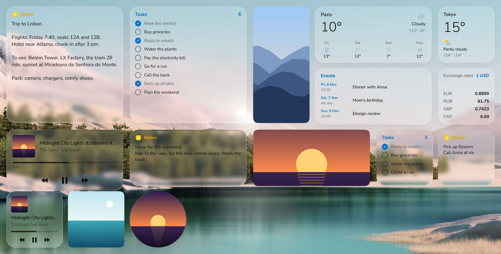

# Calmdesk

The widget gallery and widget center for Windows 11. Calmdesk is not one more app to open:
it is the one place where the desktop widgets of every app live, built-in and installed, and
it is made to feel like a part of Windows itself.







*Every built-in widget, in liquid glass with the light theme.*

**Download:** the installer is on the [Releases](https://github.com/rom5n/calmdesk/releases) page.

## A widget center, not an app

- **One gallery for all widgets.** Calmdesk lists every widget package on the PC: its own,
  and the ones other apps install. Search it, drag a widget onto the desktop or click it to
  add it. Apps ship widgets; Calmdesk shows them all the same way.
- **Feels native.** It lives in the notification area, starts with Windows and brings back the
  widgets that were on the desktop. Widgets sit below every window next to the desktop icons,
  follow the light and dark mode, the accent color and the display language, use frosted and
  liquid-glass materials, and hide while a fullscreen app runs on their monitor. There is no
  main window to manage.
- **One settings menu.** Right-click any widget for the same Edit menu: size, background,
  theme, corners, font, colors and the widget's own options. A new widget starts with the style
  last picked for that kind of widget.
- **Light on the PC.** Rendered on the GPU by [widget-engine](https://github.com/rom5n/widget-engine),
  about 0% CPU while idle.

## For widget authors

Make your widgets for Calmdesk, so users find them in the one gallery they already use,
with the same look and the same settings menu as every other widget.

1. Build the package with [widget-engine](https://github.com/rom5n/widget-engine): a folder
   with `widget.toml` and `layout.xml`. The engine's
   [guide](https://github.com/rom5n/widget-engine/blob/main/docs/guide.md) goes step by step.
2. Give it a unique reverse-domain `id` (`com.yourname.weather`), keep `engine = "^0.1"`, and
   allow the customizations that make sense (`size`, `background`, `theme`, ...), so it fits
   in with the built-in widgets.
3. Feed live values from your app with `widget_engine::host` (Rust) or `we_host_set` (C);
   Calmdesk shows the widget in its own process and passes clicks back to your app.
4. Install it to `%LOCALAPPDATA%\Widgets\<package>`, `%ProgramData%\Widgets\<package>`, or
   register its folder under `HKCU\Software\WidgetEngine\Packages`. Calmdesk finds it the next
   time the gallery opens.

Details: [Getting into the Calmdesk gallery](https://github.com/rom5n/widget-engine/blob/main/docs/authoring.md#getting-into-the-calmdesk-gallery)
and [Publishing a package](https://github.com/rom5n/widget-engine/blob/main/docs/authoring.md#publishing-a-package).

## Built-in widgets

Clocks (digital with and without a background, analog, both together, world clock),
calendar, Now Playing, weather, battery, Wi-Fi / Bluetooth / energy saver / airplane mode
switches, photos (a picked photo or folder, else the Pictures folder), notes and tasks (text
files the widget opens in Notepad), screen time, timer, stopwatch and pomodoro, system
monitor (processor, memory, graphics), Bluetooth device battery, exchange rates, calendar
events (iCalendar links, such as a Google or Outlook calendar's secret address) and a smart
stack (clock, weather and load in turns).

Calmdesk feeds them (`crates/manager/src/feeds.rs`, `timers.rs`, `sensors.rs`, `events.rs`).
Weather comes from Open-Meteo for the city of the PC's IP address (ipinfo.io), and the last
forecast is shown offline. Rates come from Exchange Rate API (open.er-api.com).

## Settings

The tray menu's Settings: start with Windows, hide widgets during fullscreen apps (only on
that app's monitor), language, export and import (through `Documents\Calmdesk backup`), the
log folder (`%LOCALAPPDATA%\calmdesk\calmdesk.log`, crash reports next to it) and the update
check (GitHub releases of this repository, once a day).

Fonts in `fonts/` (Google Fonts, SIL Open Font License, licenses next to them) ship with
Calmdesk; widgets can pick them like installed fonts.

## Building

Calmdesk builds against a checkout of widget-engine next to this one:

```
some-folder/
  engine/     https://github.com/rom5n/widget-engine
  calmdesk/   this repository
```

```bash
git clone https://github.com/rom5n/widget-engine.git engine
```

```bash
git clone https://github.com/rom5n/calmdesk.git calmdesk
```

```bash
cd calmdesk
```

```bash
cargo build --release -p calmdesk
```

```bash
cargo build --release -p calmdesk-setup
```

`target/release/calmdesk-setup.exe` is the installer: one exe with Calmdesk and the built-in
widgets inside. It installs for the current user (no admin rights) to
`%LOCALAPPDATA%\Programs\Calmdesk`, adds a Start menu shortcut and an Apps & features entry,
and turns on the start with Windows. Uninstall from Apps & features. Build `calmdesk` first:
the installer packs the `calmdesk.exe` it finds next to it. It replaces an install from when
the app was called Widget Center or Widget Manager, and moves the widgets over.

Signing: with a code-signing certificate in the user's store, set `CALMDESK_CERT` to its
thumbprint and run `tools\sign.ps1 target\release\calmdesk.exe` before building the
installer, then `tools\sign.ps1 target\release\calmdesk-setup.exe`.

## Layout of this repository

| Path | What |
|---|---|
| `crates/manager` | Calmdesk: tray, widget gallery, package scan, autostart, data feeds |
| `crates/installer` | `calmdesk-setup.exe`: the installer |
| `crates/media` | Now Playing feed (Windows media session API) for `widgets/media`, also a standalone app |
| `widgets/` | The built-in widget packages |
| `tools/` | `gen_widgets.py` writes most of `widgets/`; `tr.py` holds their translations |
| `fonts/` | Shipped fonts (SIL Open Font License) |
| `schemas/` | Copies of the engine's schemas, for editors |

## License

MIT, see [LICENSE](LICENSE).
